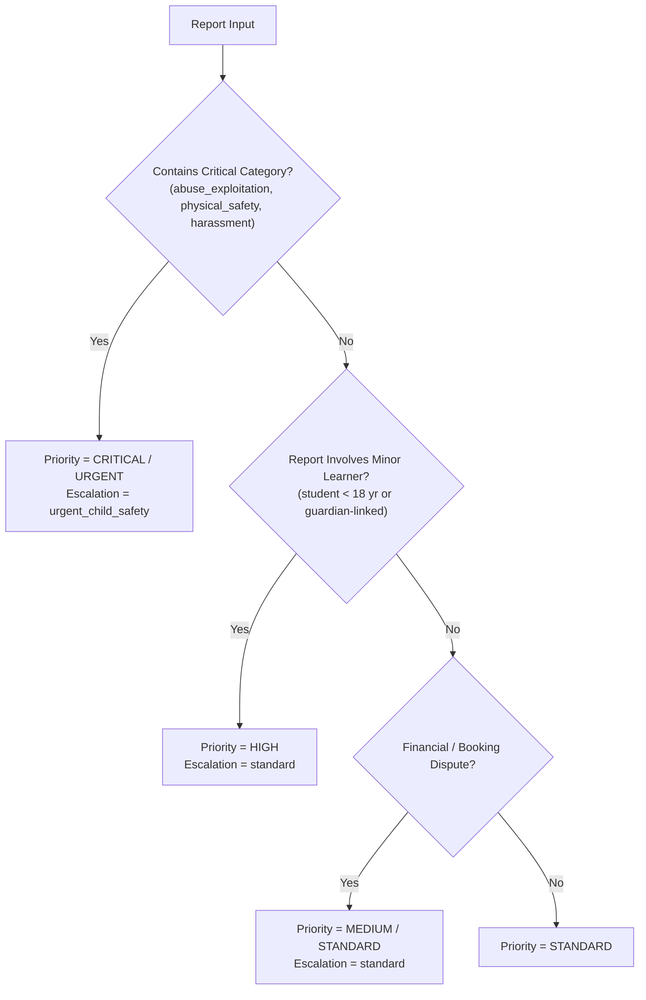

# Case Classification and Prioritization Rules

**Document Identifier:** `RULES-SAFEGUARDING-CLASS-001`  
**Platform:** OgroniEdu (অগ্রণী এডু)  
**Governing Standard:** The Children Act, 2013 (শিশু আইন, ২০১৩)

---

## 1. Report Categories & Definitions

The platform provides granular report categorization to ensure allegations and complaints are immediately routed to the appropriate operational and legal teams:

| Category Code                 | Display Name (English)             | Display Name (বাংলা)               | Severity Baseline | Primary Queue              |
| :---------------------------- | :--------------------------------- | :--------------------------------- | :---------------: | :------------------------- |
| `general_complaint`           | General Service Complaint          | সাধারণ পরিষেবা অভিযোগ              |   Low / Medium    | Customer Support           |
| `tutor_conduct`               | Tutor Conduct Concern              | শিক্ষকের আচরণ সংক্রান্ত উদ্বেগ     |   Medium / High   | Safeguarding Desk          |
| `student_guardian_conduct`    | Student / Guardian Conduct Concern | শিক্ষার্থী / অভিভাবকের আচরণ        |      Medium       | Compliance Desk            |
| `inappropriate_communication` | Inappropriate Communication        | অনুপযুক্ত বা অনাকাঙ্ক্ষিত বার্তা   |       High        | Safeguarding Desk          |
| `harassment_bullying`         | Harassment or Bullying             | হয়রানি বা বুলিং                   |  High / Critical  | Safeguarding Desk          |
| `discrimination`              | Discrimination or Bias             | বৈষম্যমূলক আচরণ                    |       High        | Compliance Desk            |
| `abuse_exploitation`          | Suspected Abuse or Exploitation    | শোষণ বা নির্যাতনের আশঙ্কা          |   **Critical**    | **Emergency Safeguarding** |
| `physical_safety`             | Physical Safety Concern            | শারীরিক নিরাপত্তার ঝুঁকি           |   **Critical**    | **Emergency Safeguarding** |
| `privacy_data_exposure`       | Privacy or Data Exposure           | গোপনীয়তা লঙ্ঘন বা তথ্য ফাঁস       |       High        | Security & Privacy         |
| `booking_dispute`             | Booking or Service Dispute         | টিউশন বা সেশন সংক্রান্ত বিরোধ      |   Medium / High   | Disputes Queue             |
| `payment_refund`              | Payment or Refund Dispute          | পেমেন্ট বা রিফান্ড সংক্রান্ত বিরোধ |   Medium / High   | Finance Operations         |
| `other`                       | Other Unspecified Concern          | অন্যান্য উদ্বেগ                    |   Low / Medium    | Support Triage             |

---

## 2. Server-Side Prioritization Matrix

Client requests submit category, incident narrative, and requested urgency, but the **final case priority is calculated strictly by the server**:

### Priority Definitions & SLAs:

1. **`critical`:** Imminent risk of physical violence, child sexual abuse/grooming, criminal threat, or active extortion.
   - **Triage SLA:** < 30 minutes.
   - **Automatic Action:** Emergency Outbox event dispatched; protective tutor hold evaluation triggered.
2. **`urgent`:** Serious verbal abuse, aggressive harassment, unconsented PII solicitation, or severe misconduct.
   - **Triage SLA:** < 2 hours.
3. **`high`:** Repeated missed sessions, persistent unprofessionalism, financial fraud attempts, or unauthorized recording.
   - **Triage SLA:** < 8 hours.
4. **`standard`:** Minor curriculum misalignment, general platform queries, non-urgent billing feedback.
   - **Triage SLA:** < 24 hours.

---

## 3. Human Review & Classification Override

1. Authorized compliance reviewers and administrators may override the calculated priority or category after initial assessment.
2. Any classification change requires an explicit justification string and is permanently logged in `safety_case_events` with the reviewer's user ID and timestamp.
3. Priority cannot be downgraded from `critical` without documented senior investigator review.
