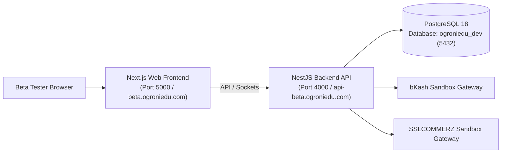

# Phase 12: User Acceptance Testing, Beta Launch & Stabilization — Beta Environment Specification

## 1. Environment Architecture & Port Topology

The beta testing environment operates with complete isolation from any production infrastructure.



---

## 2. Service Endpoints & Configuration

| Service Component                | Beta / Staging Endpoint                      | Local Development Endpoint          |      Operational State      |
| :------------------------------- | :------------------------------------------- | :---------------------------------- | :-------------------------: |
| **Web Frontend**                 | `https://beta.ogroniedu.com`                 | `http://localhost:5000`             |  Active (SSR + Strict CSP)  |
| **Backend API**                  | `https://api-beta.ogroniedu.com/api/v1`      | `http://localhost:4000/api/v1`      |  Active (Express + NestJS)  |
| **WebSocket Gateway**            | `wss://api-beta.ogroniedu.com/notifications` | `ws://localhost:4000/notifications` | Active (Socket.IO with JWT) |
| **Database**                     | PostgreSQL 18 (`ogroniedu_staging`)          | PostgreSQL 18 (`ogroniedu_dev`)     |     Active (Port 5432)      |
| **Payment Gateway (bKash)**      | `https://tokenized.sandbox.bka.sh`           | Simulated Adapter / Sandbox         |     Sandbox Mode Active     |
| **Payment Gateway (SSLCOMMERZ)** | `https://sandbox.sslcommerz.com`             | Simulated Adapter / Sandbox         |     Sandbox Mode Active     |
| **Object Storage**               | Staging S3 / MinIO (`ogroniedu-beta`)        | Local Mock / Temp FS                |     Mock Storage Active     |

---

## 3. Strict Production Isolation Guards

1. **Database Safeguard:** Database migration and seeding scripts check `isProduction`:
   ```typescript
   if (process.env.NODE_ENV === 'production') {
     throw new Error('PRODUCTION SAFETY INVARIANT: Seeding demo users in production is forbidden.');
   }
   ```
2. **Zero Real Financial Transactions:** Both payment adapters operate in sandbox mode:
   - `BKASH_IS_SANDBOX=true`
   - `SSLCOMMERZ_IS_SANDBOX=true`
   - Real bank accounts, mobile financial wallets, or live credit cards are rejected with sandbox error mocks.
3. **Suppressed Live Communication:** SMS and WhatsApp dispatchers operate in simulation mode (`SMS_PROVIDER=mock`), logging outgoing OTPs and alerts to the development console to prevent unintended messages to real phone numbers.

---

## 4. Key Environment Variables

```bash
# Server & Runtime
NODE_ENV=development
PORT=4000
API_PREFIX=api/v1

# Security & Sessions
JWT_SECRET=super-secret-beta-jwt-key-minimum-32-chars
JWT_ACCESS_EXPIRATION=900
JWT_REFRESH_EXPIRATION=604800
CORS_ORIGIN=http://localhost:5000

# Database
DB_HOST=localhost
DB_PORT=5432
DB_USER=postgres
DB_PASSWORD=password
DB_NAME=ogroniedu_dev

# Gateways (Sandbox Mode Strictly Enforced)
BKASH_IS_SANDBOX=true
BKASH_APP_KEY=sandbox-app-key
BKASH_APP_SECRET=sandbox-app-secret
SSLCOMMERZ_IS_SANDBOX=true
SSLCOMMERZ_STORE_ID=testbox
SSLCOMMERZ_STORE_PASSWD=qwerty

# Feature Flags & Beta Mode
FEATURE_BETA_FEEDBACK=true
FEATURE_DYNAMIC_COMMISSION=true
```

---

## 5. Health Verification & Smoke Check

- Backend Health Check: `GET /api/v1/health` $\to$ Returns HTTP 200 with database connectivity and memory metrics.
- Frontend Health Check: `GET /bn/tutors` $\to$ Returns HTTP 200 with full SSR layout and security headers.
- Data Reset Procedure:
  ```bash
  pnpm db:migrate
  pnpm db:seed
  ```
