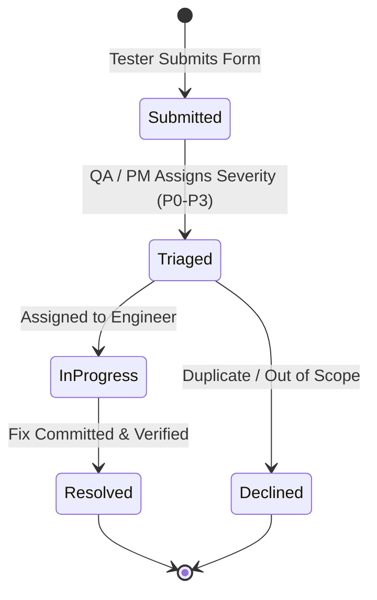

# Phase 12: User Acceptance Testing, Beta Launch & Stabilization — Feedback & Bug Triage

## 1. Beta Feedback Subsystem Architecture

To support structured, privacy-preserving feedback collection throughout User Acceptance Testing (UAT) and the controlled beta release, OgroniEdu implements a dedicated `BetaFeedback` domain.

---

## 2. Beta Feedback Record Schema

The `beta_feedback` database table (Migration `029_beta_testing_and_feedback.sql`) persists feedback records with strict schema constraints:

| Field Name | Type | Description & Validation |
| :--- | :--- | :--- |
| `id` | `UUID` | Primary key generated via `uuid_generate_v4()`. |
| `reporter_user_id` | `UUID` | Foreign key referencing `users.id` (nullable for anonymous feedback, populated when authenticated). |
| `reporter_role` | `VARCHAR(50)` | Role held by reporter at time of submission (`student`, `tutor`, `guardian`, etc.). |
| `category` | `VARCHAR(50)` | One of: `bug`, `usability`, `feature_request`, `performance`, `accessibility`, `other`. |
| `title` | `VARCHAR(200)` | Concise summary of the feedback (3-200 characters). |
| `description` | `TEXT` | Detailed explanation of the issue or suggestion (10-5000 characters). |
| `route` | `VARCHAR(255)` | Application route where the feedback was triggered (e.g. `/bn/tutors`). |
| `reproduction_steps` | `TEXT` | Optional step-by-step instructions to reproduce a reported bug. |
| `diagnostic_metadata` | `JSONB` | Optional non-PII diagnostic metadata (viewport, user agent, locale, network status). |
| `severity` | `VARCHAR(20)` | Triage severity: `p0_critical`, `p1_high`, `p2_medium`, `p3_low` (default: `null` until triaged). |
| `status` | `VARCHAR(30)` | Workflow state: `submitted`, `triaged`, `in_progress`, `resolved`, `declined`. |
| `assigned_to_user_id` | `UUID` | Staff member assigned to review or resolve the issue. |
| `triage_notes` | `TEXT` | Internal engineering/QA notes (restricted from end-user view). |
| `created_at` | `TIMESTAMPTZ` | Submission timestamp (UTC). |
| `updated_at` | `TIMESTAMPTZ` | Last status modification timestamp. |

---

## 3. Feedback Categories & Use Cases

1. **`bug` (Unexpected Behavior):**
   - Application crash, unhandled error toast, invalid state transition, calculation mismatch.
2. **`usability` (Confusing Interface):**
   - Unclear button labels, missing guidance, ambiguous form instructions, counter-intuitive navigation.
3. **`feature_request` (Missing Capability):**
   - Requested workflow enhancement (e.g., downloadable attendance PDF, WhatsApp reminder option).
4. **`performance` (Latency / Slowness):**
   - Page load duration $>2\text{s}$, sluggish typing responsiveness, slow search query execution.
5. **`accessibility` (A11y / Inclusivity):**
   - Keyboard focus trap, missing aria attributes, illegible contrast in light/dark mode.
6. **`other` (General Observations):**
   - General feedback on platform value, tutor quality, or curriculum completeness.

---

## 4. Triage Severity Criteria (P0 through P3)

### P0 — Critical (Immediate Release Blocker)
- **Criteria:** Security vulnerability, authentication bypass, data leak between users or tenants, unauthorized access to child safeguarding reports, double-entry financial corruption, server panic.
- **Action:** Halts staging deployment. Engineer assigned within 1 hour; hotfix required within 4 hours.

### P1 — High (Workflow Blocker)
- **Criteria:** Core business workflow completely inoperable for a role with no viable workaround (e.g. tutor cannot accept booking, guardian cannot complete checkout, student cannot join classroom).
- **Action:** Blocks candidate promotion to release. Resolution required within 24 hours.

### P2 — Medium (Degraded Experience)
- **Criteria:** Secondary feature failure, confusion causing repeated user errors, layout glitch with an available workaround.
- **Action:** Prioritized for resolution in the active stabilization sprint (within 72 hours).

### P3 — Low (Minor Cosmetic / Polish)
- **Criteria:** Minor visual alignment, typo in copy, non-essential aesthetic improvement.
- **Action:** Scheduled for regular post-launch maintenance.

---

## 5. Security & Privacy Safeguards

- **Strict Access Control:** End-users can only inspect their own submitted feedback (`GET /api/v1/feedback/my`). Access to the global triage queue (`GET /api/v1/admin/feedback`) requires `admin`, `super_admin`, or `support_agent` clearance.
- **Internal Note Confidentiality:** `triage_notes` are stripped from client-facing responses and visible only to administrative triage reviewers.
- **Rate Limiting:** Users are capped at 10 feedback submissions per hour to prevent spam or denial-of-service abuse.
- **Zero Sensitive Data Storage:** Client-side form specifically warns users never to submit passwords, credit card numbers, OTPs, or private chat screenshots.
