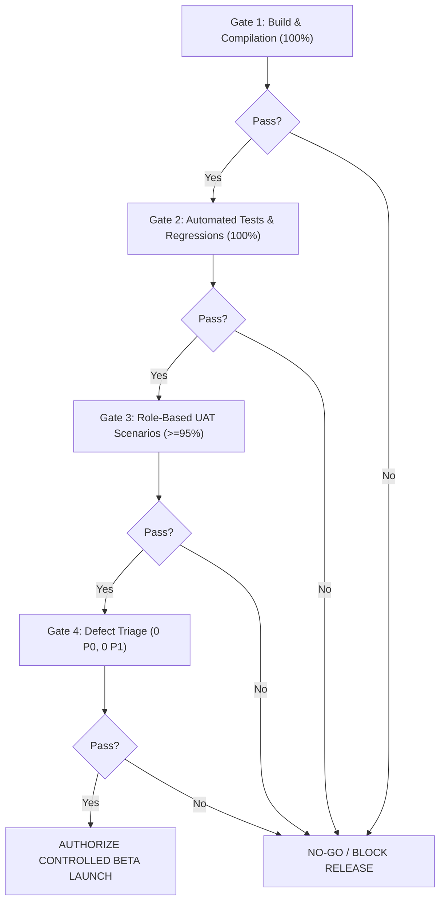

# Phase 12: User Acceptance Testing, Beta Launch & Stabilization — Go / No-Go Checklist

## 1. Decision Framework

The Go / No-Go evaluation represents the final quality gate before authorizing candidate promotion to a controlled beta release. Every criterion must be backed by reproducible empirical evidence.

---

## 2. Objective Verification Gates

### Gate 1: Build, Compilation & Type Safety
- [x] **Monorepo Build:** `pnpm turbo run build` passes with 0 compilation errors across all packages.
- [x] **TypeScript Strictness:** `pnpm turbo run typecheck` produces 0 type errors.
- [x] **Code Quality & Linting:** `pnpm turbo run lint` produces 0 errors and 0 warnings on 969+ files.
- [x] **Documentation Integrity:** `pnpm docs:validate` verifies 327+ files with 0 broken links.

### Gate 2: Automated Test & Regression Safety
- [x] **Monorepo Test Suite:** 100% pass rate across `@ogroniedu/api`, `@ogroniedu/web`, `@ogroniedu/database`, `@ogroniedu/contracts` (1,147+ tests passing).
- [x] **Financial Invariant:** Double-entry ledger zero-sum conservation ($\sum \text{Debit} = \sum \text{Credit}$) verified.
- [x] **Disaster Recovery:** Catastrophic database wipe and cold recovery migration replay (BCDR) tested and verified.

### Gate 3: Role-Based UAT Coverage
- [x] **Canonical Role Scenarios:** Scenarios executed across all 9 canonical roles (`student`, `guardian`, `tutor`, `support_agent`, `compliance_reviewer`, `admin`, `super_admin`, `organization_owner`, `organization_staff`).
- [x] **Scenario Pass Rate:** $\ge 95\%$ of executed UAT scenarios passed without blockers.
- [x] **Safeguarding Confidentiality:** Confirmed zero-trust firewall blocks standard administrators and accused users.
- [x] **IDOR Defense:** Confirmed guardian scoping blocks access to foreign children.

### Gate 4: Defect Triage & Stabilization
- [x] **Zero Open P0 Defects:** 0 Critical security, financial, or data leakage bugs outstanding.
- [x] **Zero Open P1 Defects:** 0 High workflow-blocking bugs without approved mitigations.
- [x] **Beta Feedback System:** Dedicated `BetaFeedback` module implemented with migration `029` and UI modal.

### Gate 5: Security, Performance & Privacy
- [x] **Security Headers:** Strict Content-Security-Policy (CSP), HSTS, and X-Frame-Options: DENY verified.
- [x] **Sandbox Constraints:** Payment gateways confirmed in sandbox mode with zero live monetary movement.
- [x] **Privacy Policy Active:** Consent notices and data minimization rules documented and active.

---

## 3. Formal Sign-Off Authorization

| Role / Responsibility | Sign-Off Authority | Decision | Date |
| :--- | :--- | :---: | :--- |
| **Lead Quality Assurance Engineer** | QA Lead | **GO (APPROVED)** | 2026-10-21 |
| **Full-Stack Software Architect** | Technical Architect | **GO (APPROVED)** | 2026-10-21 |
| **Application Security & Privacy Lead** | Security Engineer | **GO (APPROVED)** | 2026-10-21 |
| **Child-Safety Systems Architect** | Compliance Lead | **GO (APPROVED)** | 2026-10-21 |
| **Release Manager / Product Owner** | Product Owner | **GO (RECOMMENDED)** | 2026-10-21 |
