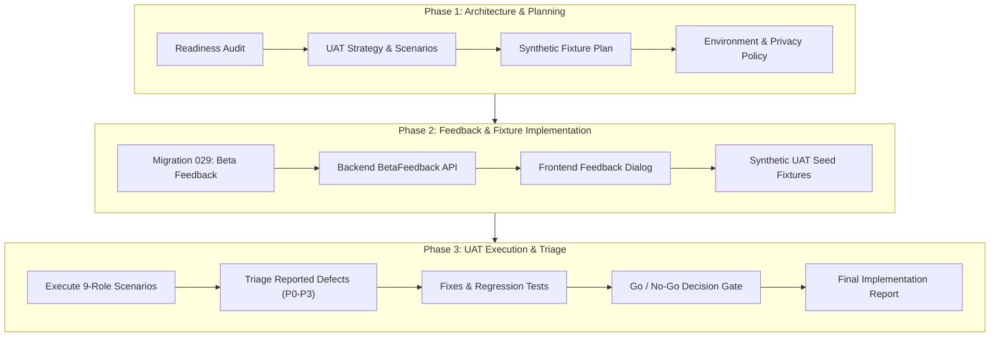

# Phase 12: User Acceptance Testing, Beta Launch & Stabilization — Implementation Plan

## 1. Objectives & Milestones

The goal of **Phase 12: User Acceptance Testing, Beta Launch & Feedback-Driven Stabilization** is to establish a rigorous, privacy-conscious beta testing framework, verify core user journeys across all 9 canonical roles using synthetic data, deploy a dedicated structured feedback capture system, triage issues, and certify platform stabilization prior to public release.

---

## 2. Workstream Breakdown

### Workstream 1: UAT Governance & Documentation Suite
Author the comprehensive 11 pre-implementation documents and final release report in `docs/features/uat-beta/`:
1. `AUDIT.md` — Baseline readiness and gap analysis.
2. `IMPLEMENTATION_PLAN.md` — Execution roadmap and delivery milestones.
3. `UAT_STRATEGY.md` — Entry/exit criteria, tester groups, testing cadence, and defect triage guidelines.
4. `TEST_USER_AND_FIXTURE_PLAN.md` — Synthetic accounts, deterministic seeding, and isolation safeguards.
5. `ROLE_BASED_UAT_SCENARIOS.md` — Detailed step-by-step scenarios covering all 9 canonical roles.
6. `FEEDBACK_AND_BUG_TRIAGE.md` — Schema, lifecycle states, triage matrix, and confidentiality controls.
7. `BETA_ENVIRONMENT.md` — Infrastructure specifications, sandbox settings, and zero-production guards.
8. `RELEASE_AND_ROLLBACK_PLAN.md` — Prerequisites, smoke tests, rollback procedures, and disaster recovery.
9. `PRIVACY_AND_CONSENT.md` — Data minimization, screenshot handling, and participant disclosures.
10. `GO_NO_GO_CHECKLIST.md` — Objective release gates and sign-off prerequisites.
11. `TEST_EXECUTION_RESULTS.md` — Detailed test execution records and evidence logs.
12. `IMPLEMENTATION_REPORT.md` — Final executive report and release recommendation.

### Workstream 2: Dedicated Beta Feedback Subsystem
1. **Database Schema:** Create migration `029_beta_testing_and_feedback.sql` with table `beta_feedback`:
   - Columns: `id`, `reporter_user_id`, `reporter_role`, `category`, `title`, `description`, `route`, `reproduction_steps`, `diagnostic_metadata`, `severity`, `status`, `assigned_to_user_id`, `triage_notes`, `created_at`, `updated_at`.
2. **Contracts & Validation:** Add `BetaFeedbackSchema` and DTOs in `@ogroniedu/contracts`.
3. **Backend API Endpoints:**
   - `POST /api/v1/feedback` — Submit feedback (authenticated, rate-limited to 10 per hour per user).
   - `GET /api/v1/feedback/my` — Retrieve reporter's own submitted feedback items.
   - `GET /api/v1/admin/feedback` — Administrative triage queue (filtered by category, severity, status; gated to `admin`, `super_admin`, `support_agent`).
   - `PATCH /api/v1/admin/feedback/:id/triage` — Update status, severity, assignment, and internal notes.
4. **Audit Integration:** Emit audit log on triage transitions.

### Workstream 3: Frontend Feedback UI
1. Add a persistent **"মতামত / Feedback"** trigger button across role dashboards.
2. Implement `BetaFeedbackModal` with category selection (`bug`, `usability`, `feature_request`, `performance`, `accessibility`, `other`), reproduction steps input, and route detection.
3. Connect submission to `POST /api/v1/feedback` with positive feedback toast notifications.

### Workstream 4: Synthetic UAT Scenarios & Execution
1. Execute role-based UAT scenarios covering all 9 canonical roles (`student`, `guardian`, `tutor`, `support_agent`, `compliance_reviewer`, `admin`, `super_admin`, `organization_owner`, `organization_staff`).
2. Verify critical end-to-end paths (onboarding $\to$ discovery $\to$ booking $\to$ sandbox payment $\to$ LMS classroom $\to$ feedback submission $\to$ admin triage).
3. Record test execution outcomes and evidence.

### Workstream 5: Quality Gates & Go / No-Go Decision
1. Execute monorepo tests (`pnpm turbo run test`).
2. Run TypeScript strict typecheck (`pnpm turbo run typecheck`).
3. Run monorepo linter (`pnpm turbo run lint`).
4. Validate documentation links (`pnpm docs:validate`).
5. Synthesize go/no-go evaluation based on objective evidence.
