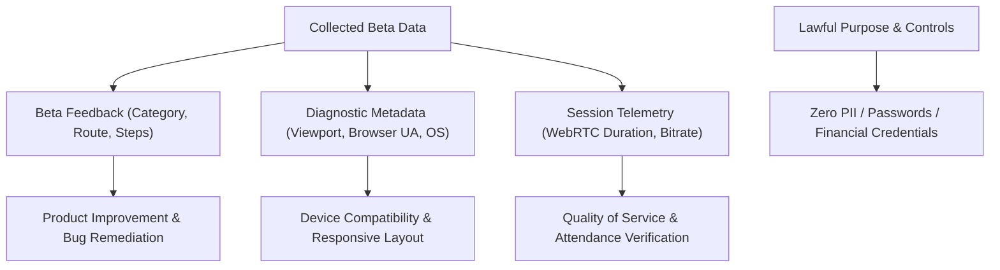

# Phase 12: User Acceptance Testing, Beta Launch & Stabilization — Privacy & Consent Policy

## 1. Privacy Principles & Purpose Specification

OgroniEdu adheres to strict data minimization, transparent consent, and minor safety protection standards throughout User Acceptance Testing (UAT) and the controlled Beta program.

---

## 2. Collected Data Fields & Justifications

| Data Field | Collection Context | Purpose & Justification | Access Clearance |
| :--- | :--- | :--- | :--- |
| **Reporter User ID & Role** | Authenticated feedback submission | Allows triage team to understand persona perspective and reply. | `admin`, `support_agent` |
| **Feedback Category & Title** | Bug / Usability / A11y report | Routing ticket to appropriate engineering domain. | `admin`, `support_agent` |
| **Reproduction Steps** | User-submitted text | Enables engineers to replicate and resolve defects. | Engineering / QA |
| **Route & Page URL** | Client context (e.g. `/bn/tutors`) | Pinpointing UI component where defect manifested. | Engineering / QA |
| **Diagnostic Metadata** | User Agent, Viewport dimensions | Diagnosing browser-specific layout or CSS issues. | Engineering / QA |
| **Session Duration** | Automated classroom telemetry | Ensuring attendance duration threshold ($\ge 80\%$). | `tutor`, `guardian`, `student` |

---

## 3. Strict Prohibitions & Confidentiality Safeguards

- **Zero Credentials or Payment Secrets:** Testers are explicitly instructed never to submit passwords, OTPs, mobile banking PINs, or national identity scans in feedback descriptions.
- **Zero Third-Party Session Replay:** The platform explicitly avoids unvetted third-party session recording scripts (e.g. Hotjar, FullStory) to prevent inadvertent capture of minor video, keystrokes, or chat logs.
- **Child Safeguarding Firewall:** Confidential child safeguarding reports and evidence remain isolated under `compliance_reviewer` clearance and are never commingled with general feedback queues.

---

## 4. Participant Disclosure & Consent Agreement

All participants in external beta testing must review and accept the **Beta Participation Agreement**:
1. **Testing Environment Disclosure:** The user understands that they are interacting with a test/beta environment featuring new capabilities.
2. **Sandbox Financials:** All payment actions utilize simulated sandbox currencies (bKash/SSLCOMMERZ Test) with zero real money deducted or owed.
3. **Voluntary Feedback:** Submitting feedback, bug reports, and suggestions is voluntary and governed by this Privacy Policy.
4. **Data Deletion Rights:** Beta participants may request the immediate deletion or anonymization of their submitted feedback records at any time.

---

## 5. Data Retention & Deletion Schedule

- **UAT & Beta Feedback:** Retained for 90 days following public launch for regression tracking, then permanently purged from `beta_feedback`.
- **Diagnostic Telemetry:** Purged automatically after 30 days.
- **Synthetic Test Fixtures:** Purged or reset upon conclusion of each test cycle.
