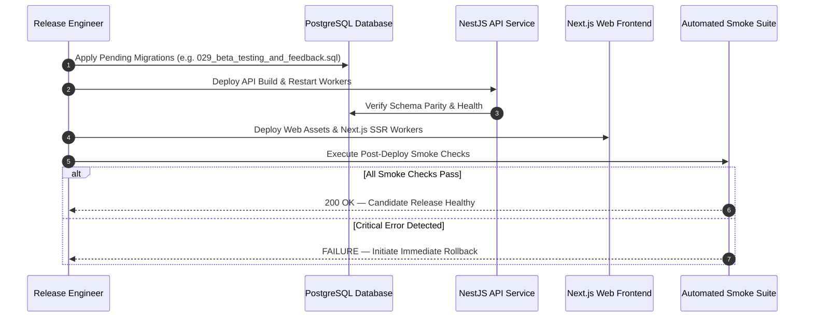

# Phase 12: User Acceptance Testing, Beta Launch & Stabilization — Release & Rollback Plan

## 1. Release Governance & Gate Prerequisites

Prior to releasing any build candidate to the beta or public environments, the candidate must satisfy:

1. **Compilation & Quality Gate:** 0 TypeScript compiler errors, 0 linter errors/warnings.
2. **Automated Test Suite:** 100% passing tests across all monorepo workspaces.
3. **UAT Sign-Off:** All P0 and P1 defects resolved or mitigated with documented workarounds.
4. **Human Authorization:** Explicit written sign-off from the Product Owner and Release Lead.

---

## 2. Deployment Sequence & Smoke Test Verification

### Automated Smoke Verification Steps

1. `GET /api/v1/health` $\to$ HTTP 200 (database alive, redis/storage operational).
2. `GET /bn/tutors` $\to$ HTTP 200 (SSR catalog renders with security headers).
3. `POST /api/v1/auth/login` $\to$ HTTP 200 (synthetic demo credentials validate).
4. `GET /api/v1/notifications` $\to$ HTTP 200 (notifications service connected).
5. `POST /api/v1/feedback` $\to$ HTTP 201 (feedback subsystem active).

---

## 3. Rollback Procedures & Strategy

### 3.1 Application Code Rollback

- **Mechanism:** Blue/Green or canary container replacement.
- **Action:** Re-route load balancer traffic to the preceding verified container image (`previous_stable_tag`).
- **Duration:** $<2\text{ minutes}$.

### 3.2 Database Migration Rollback Limitations & Forward-Recovery

- **Principle:** Reversing a database migration is high-risk because it may truncate or corrupt newly created user data (e.g. bookings, feedback).
- **Rule:** Never execute `DROP TABLE` or destructive down-migrations against active databases without evaluating data loss impact.
- **Forward-Recovery Preference:** In the event of schema defects, implement a forward patch migration rather than rolling back migrations.
- **Cold Disaster Recovery:** If database corruption occurs, restore the pre-deployment snapshot and replay transaction journals using BCDR recovery drills.

---

## 4. Rollback Triggers & SLA

| Trigger Condition         | Threshold                                          | Action                                    |        SLA        |
| :------------------------ | :------------------------------------------------- | :---------------------------------------- | :---------------: |
| **Authentication Outage** | $>1\%$ login failure rate                          | Immediate rollback to previous build      | $<15\text{ mins}$ |
| **Security / Data Leak**  | Any P0 confidentiality breach                      | Immediate traffic pause / rollback        |   **Immediate**   |
| **Ledger Imbalance**      | Any unbalanced journal error                       | Freeze financial mutations; rollback code | $<30\text{ mins}$ |
| **Elevated Latency**      | P95 latency $>3,000\text{ms}$ for $>5\text{ mins}$ | Scale worker nodes or rollback            | $<30\text{ mins}$ |

---

## 5. Incident Communication & Responsibilities

- **Incident Commander:** Senior Reliability Engineer
- **Lead Architect:** Full-Stack Tech Lead
- **Communications Lead:** Product Operations Manager
- **Status Page Updates:** Published within 15 minutes of any confirmed severity 1 service degradation.
