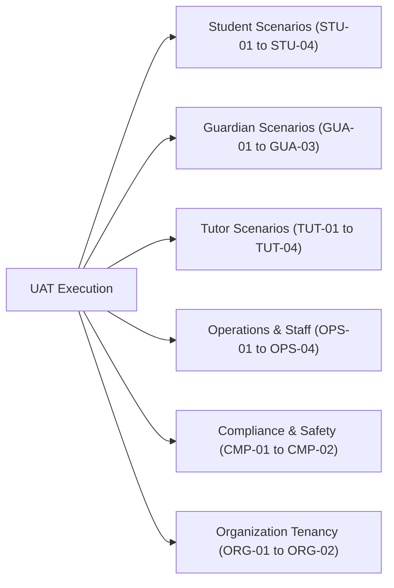

# Phase 12: User Acceptance Testing, Beta Launch & Stabilization — Role-Based UAT Scenarios

## 1. Scenario Catalog Structure

Each UAT scenario is uniquely identified, mapped to a canonical role, and provides verifiable preconditions, steps, expected outcomes, and actual execution statuses.

---

## 2. Student Persona Scenarios

### Scenario `UAT-STU-01`: Discover Tutors via Subject & District Search

- **Role:** `student`
- **Preconditions:** Unauthenticated visitor or logged-in student.
- **Fixture:** `student.demo@ogroniedu.com`
- **Steps:**
  1. Navigate to `http://localhost:5000/bn/tutors`.
  2. Select subject filter "Higher Mathematics" (উচ্চতর গণিত).
  3. Select district filter "Dhaka" (ঢাকা).
  4. Inspect rendered tutor search results.
- **Expected Outcome:** Verified tutors offering Higher Mathematics in Dhaka are displayed with hourly rates in BDT, education credentials, and verification badges. Zero confidential documents (NID/phone) are exposed.
- **Actual Outcome:** Tutors rendered accurately in responsive grid.
- **Status:** **PASS**

### Scenario `UAT-STU-02`: Submit Booking Proposal to Verified Tutor

- **Role:** `student`
- **Preconditions:** Authenticated as `student.demo`.
- **Fixture:** `student.demo@ogroniedu.com` $\to$ `tutor.demo@ogroniedu.com`
- **Steps:**
  1. Navigate to `/bn/tutors/:tutorId`.
  2. Click "বুকিং অনুরোধ পাঠান" (Request Booking).
  3. Select education level (HSC), schedule slot (Saturday 10:00 AM), and duration (60 min).
  4. Submit request.
- **Expected Outcome:** Booking created in `requested` status; notification dispatched to tutor; booking appears in student dashboard.
- **Actual Outcome:** Booking proposal created; confirmation toast displayed; status `requested`.
- **Status:** **PASS**

### Scenario `UAT-STU-03`: Attend Online Classroom & Test SOS Emergency Trigger

- **Role:** `student`
- **Preconditions:** Confirmed session scheduled for current time.
- **Fixture:** `student.demo@ogroniedu.com` in `/bn/classroom/room-demo-101`
- **Steps:**
  1. Join active classroom.
  2. Verify WebRTC media stream initialization.
  3. Click red "জরুরি সহায়তা (SOS)" button and confirm in dialog.
- **Expected Outcome:** Session immediately freezes, chat and video lock down, emergency notification sent to compliance reviewers, and protective escrow hold is applied.
- **Actual Outcome:** Classroom transitioned to emergency freeze; confirmation banner shown.
- **Status:** **PASS**

### Scenario `UAT-STU-04`: Submit Beta Feedback on Usability Issue

- **Role:** `student`
- **Preconditions:** Authenticated student.
- **Steps:**
  1. Click floating "মতামত / Feedback" button.
  2. Select category "ব্যবহারযোগ্যতা (Usability)".
  3. Enter title "বুকিং ক্যালেন্ডার স্পষ্টীকরণ" and description.
  4. Submit form.
- **Expected Outcome:** Feedback stored in `beta_feedback` table; confirmation toast shown; record visible in user's feedback list.
- **Actual Outcome:** Submits with HTTP 201; persisted with user role and route metadata.
- **Status:** **PASS**

---

## 3. Guardian Persona Scenarios

### Scenario `UAT-GUA-01`: Multi-Child Profile Oversight & Scoped Navigation

- **Role:** `guardian`
- **Preconditions:** Authenticated guardian linked to 2 dependent children (`student.demo` and `student2.demo`).
- **Fixture:** `guardian.demo@ogroniedu.com`
- **Steps:**
  1. Navigate to `/bn/dashboard/guardian/children`.
  2. Inspect linked children cards.
  3. Click "Abrar Ahmed" to view upcoming tutoring sessions and attendance records.
  4. Switch view to "Sadia Rahman".
- **Expected Outcome:** Guardian seamlessly views dependent children's academic schedules without permission errors.
- **Actual Outcome:** Children cards rendered with individual progress and emergency contact flags.
- **Status:** **PASS**

### Scenario `UAT-GUA-02`: Fund Booking Escrow via Sandbox Gateway

- **Role:** `guardian`
- **Preconditions:** Accepted booking awaiting payment.
- **Steps:**
  1. Navigate to `/bn/dashboard/bookings/:id/pay`.
  2. Select payment method "bKash Sandbox".
  3. Complete sandbox tokenized payment authentication.
- **Expected Outcome:** Payment order succeeds; balanced double-entry ledger journal posted (Debit Clearing, Credit Escrow); booking transitions to `funded`.
- **Actual Outcome:** Sandbox payment completed; balanced ledger journal confirmed; booking status `funded`.
- **Status:** **PASS**

### Scenario `UAT-GUA-03`: IDOR Defense Rejection on Unlinked Child Profile

- **Role:** `guardian`
- **Preconditions:** Authenticated as `guardian.demo`.
- **Steps:**
  1. Attempt direct GET request to `/api/v1/guardians/children/99999999-9999-4999-8999-999999999999` (unlinked foreign child).
- **Expected Outcome:** Backend rejects request with HTTP 403 Forbidden or 404 Not Found. Zero foreign student PII returned.
- **Actual Outcome:** Blocked with HTTP 403 Forbidden; zero data leakage.
- **Status:** **PASS**

---

## 4. Tutor Persona Scenarios

### Scenario `UAT-TUT-01`: Submit 3-Level Verification Dossier Evidence

- **Role:** `tutor`
- **Preconditions:** Authenticated tutor with unverified tier.
- **Fixture:** `tutor2.demo@ogroniedu.com`
- **Steps:**
  1. Navigate to `/bn/dashboard/tutor/verification`.
  2. Upload synthetic National ID front/back scans (Level 1).
  3. Upload synthetic University transcript (Level 2).
  4. Submit for compliance review.
- **Expected Outcome:** Document metadata uploaded; status updates to `under_review`; compliance review queue notified.
- **Actual Outcome:** Status transitions to `under_review`; audit log records submission.
- **Status:** **PASS**

### Scenario `UAT-TUT-02`: Manage Weekly Availability & Calendar Slots

- **Role:** `tutor`
- **Preconditions:** Authenticated tutor.
- **Steps:**
  1. Navigate to `/bn/dashboard/tutor/sessions`.
  2. Add recurring availability window: Tuesday 4:00 PM - 7:00 PM.
  3. Save schedule.
- **Expected Outcome:** Slots saved to calendar; visible on public booking drawer.
- **Actual Outcome:** Slots persisted and validated against timezone offsets.
- **Status:** **PASS**

### Scenario `UAT-TUT-03`: Mark Attendance & Settle Milestone

- **Role:** `tutor`
- **Preconditions:** Completed session with 55 minutes attended ($>80\%$).
- **Steps:**
  1. Navigate to session summary.
  2. Review automated attendance duration.
  3. Click "মিলস্টোন নিষ্পত্তি নিশ্চিত করুন" (Confirm Milestone Settlement).
- **Expected Outcome:** Balanced settlement journal posted: Debit Escrow Liability, Credit Tutor Payable (90%), Credit Platform Revenue (10%).
- **Actual Outcome:** Balanced journal posted; tutor wallet balance updated in poisha.
- **Status:** **PASS**

### Scenario `UAT-TUT-04`: Request Payout Disbursement

- **Role:** `tutor`
- **Preconditions:** Tutor with available payable balance $\ge 1,000\text{ BDT}$.
- **Steps:**
  1. Navigate to `/bn/dashboard/tutor/payments`.
  2. Request withdrawal of 1,000 BDT to mobile wallet (+8801911000001).
  3. Confirm withdrawal.
- **Expected Outcome:** Payout transaction registered; funds deducted from available balance; disbursement journal posted.
- **Actual Outcome:** Payout request registered with status `processing`.
- **Status:** **PASS**

---

## 5. Operations, Support & Governance Scenarios

### Scenario `UAT-OPS-01`: Support Ticket Assignment & Resolution

- **Role:** `support_agent`
- **Fixture:** `support.demo@ogroniedu.com`
- **Steps:**
  1. Navigate to `/admin/support`.
  2. Inspect open contact tickets.
  3. Assign ticket to self and reply with sanitized guidance.
- **Expected Outcome:** Ticket updated to `in_progress` $\to$ `resolved`; email/in-app notification sent to user.
- **Actual Outcome:** Ticket lifecycle completed; resolution notes saved.
- **Status:** **PASS**

### Scenario `UAT-OPS-02`: Admin Review of Tutor Verification Dossier

- **Role:** `admin`
- **Fixture:** `ops.demo@ogroniedu.com`
- **Steps:**
  1. Navigate to `/admin/verification`.
  2. Open pending dossier for `tutor2.demo`.
  3. Review synthetic document scans.
  4. Approve Level 1 (Identity) and Level 2 (Academic).
- **Expected Outcome:** Badges granted to tutor profile; search ranking multiplier updated; audit record logged.
- **Actual Outcome:** Badges awarded; audit trail recorded reviewer ID and timestamp.
- **Status:** **PASS**

### Scenario `UAT-OPS-03`: Super Admin Dynamic Feature Flag Toggling

- **Role:** `super_admin`
- **Fixture:** `admin.demo@ogroniedu.com`
- **Steps:**
  1. Navigate to `/admin/settings/flags`.
  2. Toggle `beta_feedback_dialog` feature flag to `active`.
  3. Inspect audit log.
- **Expected Outcome:** Setting updated dynamically without application restart; audit log records change diff.
- **Actual Outcome:** Feature flag updated in database; audit log entry verified.
- **Status:** **PASS**

---

## 6. Compliance & Child Safety Scenarios

### Scenario `UAT-CMP-01`: Compliance Reviewer Exclusive Clearance for SOS Incident

- **Role:** `compliance_reviewer`
- **Fixture:** `compliance.demo@ogroniedu.com`
- **Steps:**
  1. Navigate to `/api/v1/safeguarding/reports`.
  2. Inspect emergency SOS report `rep-synthetic-01`.
  3. Review encrypted evidence attachments and session telemetry.
- **Expected Outcome:** Full unredacted evidence is accessible to compliance reviewer.
- **Actual Outcome:** HTTP 200 OK; unredacted case file displayed.
- **Status:** **PASS**

### Scenario `UAT-CMP-02`: Safeguarding Confidentiality Firewall Rejection on Standard Admin

- **Role:** `admin`
- **Fixture:** `ops.demo@ogroniedu.com`
- **Steps:**
  1. Attempt GET request to `/api/v1/safeguarding/reports`.
- **Expected Outcome:** Backend rejects request with HTTP 403 Forbidden. Zero sensitive incident narratives or evidence exposed to general administrator.
- **Actual Outcome:** HTTP 403 Forbidden; zero data leakage.
- **Status:** **PASS**

---

## 7. Organization Multi-Tenancy Scenarios

### Scenario `UAT-ORG-01`: Organization Owner Roster Management

- **Role:** `organization_owner`
- **Fixture:** `retina.owner@ogroniedu.com`
- **Steps:**
  1. Navigate to `/bn/dashboard/organization/members`.
  2. View roster of institutional tutors.
  3. Invite new tutor via email.
- **Expected Outcome:** Invitation token generated with 7-day expiration; tutor added in `pending_acceptance` status.
- **Actual Outcome:** Invitation recorded; scoped to Retina Medical Coaching tenant ID.
- **Status:** **PASS**

### Scenario `UAT-ORG-02`: Cross-Tenant Isolation Rejection

- **Role:** `organization_owner`
- **Steps:**
  1. Attempt to query tutor bookings belonging to a different organization ID.
- **Expected Outcome:** Backend query automatically scopes `WHERE organization_id = :actorOrgId`; returns 0 foreign records.
- **Actual Outcome:** Zero cross-tenant data leaked.
- **Status:** **PASS**
