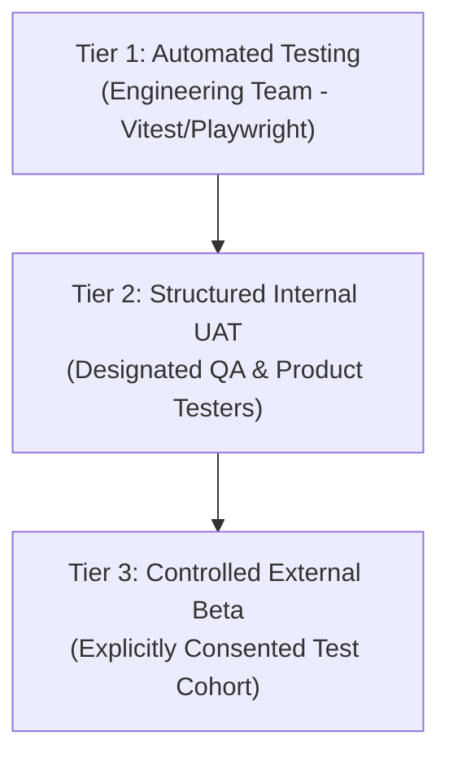

# Phase 12: User Acceptance Testing, Beta Launch & Stabilization — UAT Strategy

## 1. Purpose & Core Principles

The primary objective of the User Acceptance Testing (UAT) and Beta Launch strategy is to evaluate the end-to-end user experience, uncover real-world usability friction, validate operational workflows, and verify platform stability before initiating general public availability.

### Three Distinct Testing Tiers

1. **Automated Testing:** Executed continuously by engineering (Vitest, Playwright, TypeScript compiler, OxLint) to guarantee contract parity, schema migrations, and non-regression.
2. **Structured Internal UAT:** Scenario-driven evaluation conducted by designated internal testers assuming synthetic roles across all 9 canonical personas.
3. **Controlled External Beta:** Closed-cohort external testing with invited students, guardians, and tutors under explicit consent agreements and sandbox financial constraints.

> [!IMPORTANT]
> Automated tests verify functional specifications, but they are **never** represented as human user acceptance testing. UAT results must document human or headful browser evaluation.

---

## 2. Target Tester Groups & Canonical Personas

The UAT strategy covers all 9 canonical roles defined in the platform contracts:

| Tester Cohort | Target Profile | Key Journey Focus |
| :--- | :--- | :--- |
| **Learners (`student`)** | Secondary & Higher Secondary students | Discovery, booking requests, joining online classroom, homework submission, rating tutor. |
| **Parents (`guardian`)** | Parents managing 1+ children | Child linking, calendar oversight, funding escrow, attendance alerts, emergency contact. |
| **Educators (`tutor`)** | Independent tutors (BUET/DU alumni) | Profile completion, 3-level verification dossier submission, calendar setup, session delivery, payout requests. |
| **Customer Support (`support_agent`)** | Platform support personnel | Ticket intake, category routing, resolution messaging, escalation protocols. |
| **Compliance (`compliance_reviewer`)** | Child safety & legal reviewers | Unredacted incident evidence review, SOS case investigation, tutor sanctioning. |
| **Platform Operators (`admin`)** | Operational administrators | Tutor application review, subject taxonomy, booking arbitration, audit inspection. |
| **Platform Leadership (`super_admin`)** | Executive administrators | Dynamic feature flag toggling, platform fee configuration, staff provisioning. |
| **Agency Directors (`organization_owner`)** | Tutoring institution owners | Organization registration, tutor roster management, agency revenue split. |
| **Agency Operators (`organization_staff`)** | Tutoring agency coordinators | Day-to-day session scheduling, roster assignment, student enrollment. |

---

## 3. Entry & Exit Criteria

### 3.1 UAT Entry Criteria
Before a module or workflow enters user acceptance testing, it must satisfy:
1. **Automated Baseline:** 100% pass rate on relevant automated test suites.
2. **Backend Operational:** API services responding with verified HTTP envelopes and database persistence.
3. **Authorization Gated:** RBAC and ABAC guards active on all endpoints.
4. **Isolated Test Environment:** Running against a staging or test database (`ogroniedu_dev` / `ogroniedu_staging`) with zero connection to production.
5. **Sandbox Integrations:** Payment gateways operating strictly in sandbox mode (`bKash Sandbox`, `SSLCOMMERZ Test`).
6. **Synthetic Credentials:** Seeded accounts provisioned for all 9 canonical roles with documented test passwords.

### 3.2 UAT Exit & Launch Readiness Criteria
A workflow is certified release-ready when:
1. **Pass Rate:** $\ge 95\%$ of planned UAT scenarios pass without workaround.
2. **Zero P0 Defects:** Zero open Critical (P0) security, financial, or data leakage bugs.
3. **Zero P1 Defects:** Zero unresolved High (P1) workflow-blocking defects without documented and approved temporary mitigations.
4. **Triage Resolution:** All submitted beta feedback triaged with assigned severity and status.
5. **Regression Safety:** All bug fixes accompanied by verified automated regression tests.
6. **Human Approval:** Formal Go/No-Go sign-off from Product Owner and QA Lead.

---

## 4. Defect Severity & Triage Taxonomy

| Severity Level | Definition | Benchmark Example | Resolution SLA |
| :---: | :--- | :--- | :---: |
| **P0 (Critical)** | System crash, data corruption, auth bypass, private minor data leak, financial double-entry imbalance. | Unauthorized user viewing confidential safeguarding report; unbalanced ledger journal. | **Immediate Block** (Within 4 hours) |
| **P1 (High)** | Core workflow blocked with no workaround; onboarding failure; escrow funding failure. | Tutor cannot submit verification document; booking accept button throws unhandled error. | **Release Block** (Within 24 hours) |
| **P2 (Medium)** | Secondary feature failure; significant confusion; reliable workaround exists. | Calendar time slot selector misaligned on mobile; filter reset button missing. | **Next Build** (Within 72 hours) |
| **P3 (Low)** | Minor cosmetic issue; typo in Bangla copy; non-blocking spacing or alignment imperfection. | Label font size inconsistency; button padding offset by 2px. | **Backlog** (Post-launch) |

---

## 5. Retest & Regression Protocol

When a defect is resolved:
1. **Root Cause Fix:** Engineer commits fix addressing the root vulnerability or logic flaw.
2. **Automated Regression Test:** Engineer writes an automated test asserting the defect is fixed and cannot reoccur.
3. **Monorepo Quality Check:** Monorepo test suite, typecheck, and linter re-run to confirm zero regressions.
4. **UAT Retest:** QA tester repeats the exact reproduction steps in the test environment to confirm resolution.
5. **State Transition:** Ticket status transitions from `in_progress` $\to$ `resolved`.
