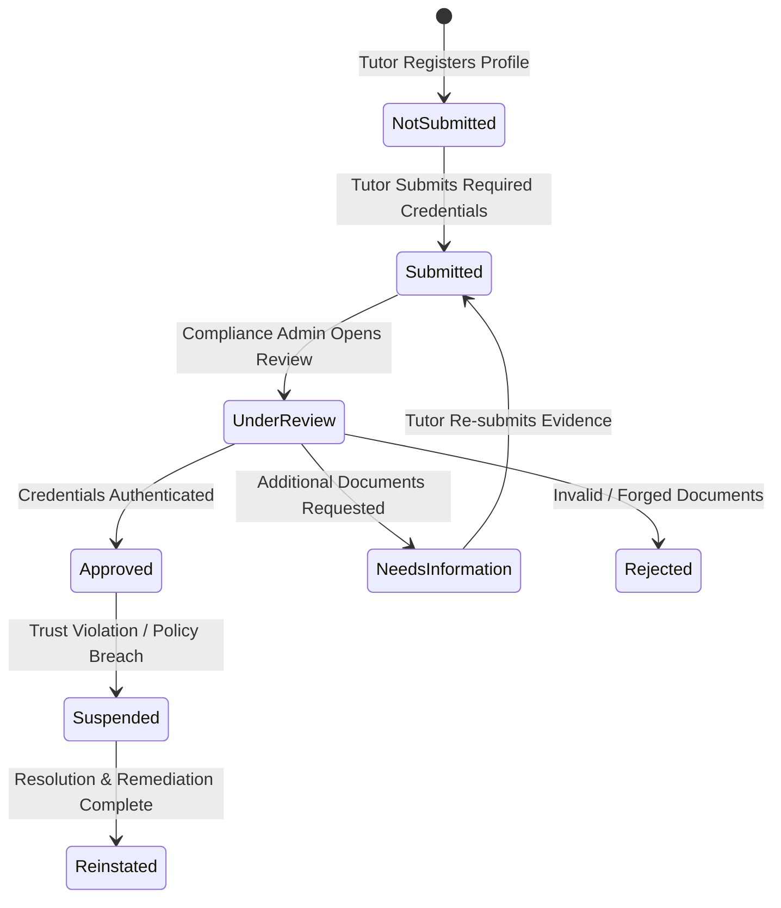

# Tutor Verification, Credential Review & Trust Policy

**Policy Identifier:** `v1.0-bd-tutor-verification`  
**Effective Date:** 2026-10-10  
**Jurisdiction:** People's Republic of Bangladesh  
**Status:** Approved Operational Security Standard  

---

## 1. Regulatory Context & Policy Objective

In the tutoring sector of Bangladesh, guardian confidence and student safety necessitate verified identity and genuine academic credentials. Private tutors interact directly with learners—frequently minors—both in-person across residences in Dhaka, Chittagong, and regional districts, and through digital classrooms.

This policy formalizes the standards, review lifecycle, privacy safeguards, and badge integrity requirements for OgroniEdu under statutory Bangladesh law:
1. **National Identity Registration Act, 2010:** Mandates valid proof of citizenship and age via Government-issued National ID (NID), Smart NID, or Machine-Readable Passport.
2. **The Penal Code, 1860 (Sections 463–471 on Forgery & Impersonation):** Strict prohibition of fraudulent academic certificates or identity representation.
3. **Cyber Security Act, 2023 & Information and Communication Technology Act, 2006:** Legal protection of sensitive digital identity records and audit trails.

---

## 2. Tutor Onboarding & Credential Verification Requirements

### 2.1 Required Credentials
To qualify for verified educator status on OgroniEdu, a tutor must provide:
1. **Primary Identity Proof:** Clear scan/photo of Government National ID (front and back) or Passport.
2. **Academic Credentials:** At least one higher secondary (HSC / A-Level) or university-level degree/transcript certificate from a recognized board (NCTB / Cambridge / Edexcel) or UGC-approved institution (e.g., BUET, DU, Medical Colleges, etc.).
3. **Private Evidence Storage:** All credential files must be uploaded to `file_assets` with `visibility = 'private'`.

### 2.2 Verification Review Lifecycle


### 2.3 Reason Codes Standard
Review decisions must record one of the following standardized reason codes:
- `CREDENTIALS_VALIDATED`: Identity and academic records verified against official standards.
- `NID_MISMATCH`: Uploaded identity document does not match user account name or date of birth.
- `CERTIFICATE_UNREADABLE`: Uploaded document is blurry, cropped, or illegible.
- `INSUFFICIENT_INFORMATION`: Missing required academic degree or enrollment proof.
- `FRAUD_SUSPECTED`: Detected alteration, digital tampering, or impersonation attempt.
- `COMPLIANCE_SUSPENSION`: Account suspended due to disciplinary review or guardian safety complaint.

---

## 3. Strict Separation of Duties & Self-Approval Denial

### 3.1 Self-Approval Denial Invariant
- **Rule:** A tutor **CANNOT** alter, approve, reinstate, or manipulate their own verification status.
- **Server Enforcement:** The tutor profile update endpoints (`PUT /api/v1/tutors/me/profile`) reject any attempt to supply `verification_status`.
- **Reviewer Identity Check:** When an admin reviews a verification dossier, the server enforces:
  ```
  IF reviewer_user_id === tutor_user_id THEN THROW ForbiddenException("Self-approval denial: Reviewer cannot verify own profile")
  ```
- **Permission Requirement:** Only accounts with the `admin` or `super_admin` role possessing permission `tutor.verification.review` can record review decisions.

---

## 4. Publication Eligibility Standard

To prevent unvetted individuals from advertising tutoring services:
1. **Publication Gate:** A tutor profile cannot be set to `published` unless:
   - `verification_status === 'approved'`
   - At least one active subject specialization is configured.
   - Profile hourly rate and teaching modes are defined.
2. **Automated Depublication:** If an approved tutor is subsequently `suspended` or `rejected`, the system automatically transitions `publication_status` to `unpublished`.

---

## 5. Verification Badges Standard (Definition of Done)

> **Definition of Done Requirement:** *Badge reflects only checks actually performed.*

The platform shall never display generic, misleading, or unearned trust marks. Verification badges rendered on public tutor cards and profiles are dynamically derived from individual, approved credential checks:
1. **`verified_identity` (পরিচয় যাচাইকৃত):** Displayed ONLY if a Government NID or Passport evidence document has been approved by compliance reviewers.
2. **`verified_academic` (শিক্ষাগত যোগ্যতা যাচাইকৃত):** Displayed ONLY if at least one degree/certificate qualification has been approved with verified institution details.
3. **`verified_background` (পটভূমি যাচাইকৃত):** Displayed ONLY if enhanced background checks have been completed and approved.

---

## 6. Private Evidence Protection & Data Redaction

1. **Access Control:** File assets attached to tutor qualifications (`evidence_asset_id`) are classified as confidential PII.
2. **Access Limitation:** Only the owning tutor and authorized compliance reviewers (`admin`, `super_admin`) may inspect or download raw credential files.
3. **Public Redaction:** Public profile endpoints (`GET /api/v1/tutors/public/:id`) strictly sanitize all data, excluding NID documents, full home addresses, private contact numbers, and reviewer notes.
