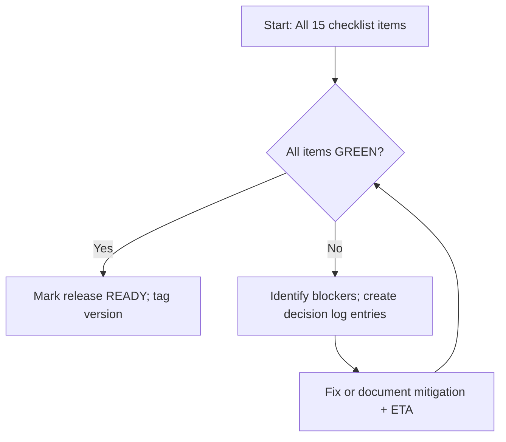

# OgroniEdu — Release Readiness Checklist

**Status:** DRAFT (Phase 11)  
**Purpose:** 15-item gate before any production release.

---

## 1. Checklist Items (15 Total)

| # | Item | Status | Verification |
|---|---|---|---|
| 1 | All 15 documentation files created and verified (`00-CURRENT-STATE.md` through `15-DECISION-AND-BLOCKER-LOG.md`) | ☐ | Review each file; confirm all inventories, registers, and phase docs present |
| 2 | Master task register complete with all task IDs, priorities, dependencies, acceptance criteria | ☐ | Review `11-MASTER-TASK-REGISTER.md`; confirm P0–P3 coverage |
| 3 | All P0/P1 security findings resolved or documented with mitigation + ETA | ☐ | Cross-reference `07-SECURITY-AUDIT.md` with `11-MASTER-TASK-REGISTER.md` |
| 4 | `@ogroniedu/auth` package extracted; all auth unit tests pass 100% | ☐ | Run `pnpm turbo run test:unit --filter=auth` |
| 5 | `@ogroniedu/payments` package extracted; provider adapters functional | ☐ | Run payment adapter sandbox tests |
| 6 | `GET /api/v1/files/:fileId/download` endpoint functional; tutor evidence retrievable | ☐ | Integration test verifies download works |
| 7 | Test-dispatch endpoint gated behind `TEST_DISPATCH_ENABLED` flag (default false) | ☐ | Verify 403 when flag off; 200 when flag on + super_admin role |
| 8 | `JWT_SECRET` fail-fast enforced in production; dev fallback removed | ☐ | App crashes on startup if `JWT_SECRET` missing (prod mode) |
| 9 | FK constraints + index optimizations applied; no data loss; typecheck passes | ☐ | Run migration `031` locally; verify queries |
| 10 | Three domain packages (`@ogroniedu/tutors`, `@ogroniedu/learning`, `@ogroniedu/trust`) build + 100% unit tests | ☐ | Run tests per package |
| 11 | All deprecated code items (DEP-001 to DEP-010) resolved or migrated | ☐ | Verify no DEP patterns in application code |
| 12 | Coverage targets met: auth ≥95%, bookings ≥95%, payments ≥95%, learning ≥90%, trust ≥90% | ☐ | Run Istanbul coverage; compare to targets |
| 13 | All E2E tests passing; flaky tests quarantined or fixed; Playwright stable | ☐ | Run `pnpm turbo run test:e2e`; zero failures |
| 14 | Master task register complete; all task IDs, priorities, dependencies, acceptance criteria present | ☐ | Review `11-MASTER-TASK-REGISTER.md` |
| 15 | Decision log maintained; blockers tracked; monitoring dashboards provisioned; alerts configured | ☐ | Verify Grafana/Prometheus; review runbooks |
| 13 | Release checklist 15 items all green; sign-off obtained from PM + Security + QA | ☐ | Collect sign-offs; document in decision log |
| 14 | 7-day execution schedule approved; resource conflicts resolved; capacity <80% | ☐ | Review capacity chart; confirm schedule |
| 15 | Monitoring dashboards provisioned; on-call runbooks documented; alerts configured | ☐ | Verify Grafana/Prometheus; review runbooks |

---

## 2. Release Gate Workflow

---

## 3. Sign-Off Requirements

| Role | Required Signature | Method |
|---|---|---|
| Product Manager | Release readiness confirmation | Written approval in decision log |
| Security Officer | P0/P1 findings resolved | Written approval in decision log |
| QA Lead | Test coverage + E2E passing | Written approval in decision log |
| Release Lead | Checklist all green + sign-offs collected | Written approval in decision log |

---

## 4. Post-Release Monitoring (First 7 Days)

| Metric | Threshold | Action if Breached |
|---|---|---|
| Error rate (5xx) | > 1% of requests | Immediate rollback consideration |
| Auth failure rate | > 0.5% of auth attempts | Investigate JWT_SECRET/config |
| Payment failure rate | > 2% of payment attempts | Review provider adapter logs |
| E2E test regression | Any new failure | Pause new deployments |
| Health check status | Any `ready: false` | Investigate dependency outage |

---

*End of `14-RELEASE-READINESS-CHECKLIST.md`.*