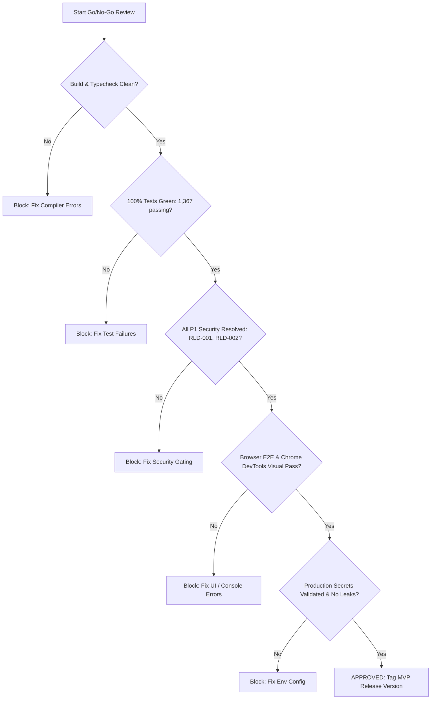

# OgroniEdu — Master Release Readiness Checklist (Go/No-Go Gate)

**Status:** AUDITED & OPERATIONAL  
**Date:** 2026-10-24  
**Scope:** Final evidence-based scorecard required before production MVP launch.

---

## 1. Evidence-Based Release Criteria

| # | Domain | Requirement | Verification Command / Evidence | Status |
|---|---|---|---|---|
| 1 | **Build Integrity** | Production build passes cleanly with zero compiler errors across all 5 workspaces | `pnpm build` | ✅ READY |
| 2 | **Typecheck** | Zero TypeScript type errors across all packages | `pnpm typecheck` | ✅ READY |
| 3 | **Linting** | Zero linter errors and zero linter warnings across frontend and backend | `pnpm lint` | ⏳ PENDING (`TDD-003`) |
| 4 | **Test Environment** | Vitest runs green with test environment variables configured (`JWT_SECRET`) | `pnpm test` | ⏳ PENDING (`TDD-001`) |
| 5 | **Frontend Unit Tests** | 100% of frontend component and state tests passing (308/308) | `pnpm --filter @ogroniedu/web test` | ⏳ PENDING (`TDD-002`) |
| 6 | **Backend Unit Tests** | 100% of backend unit and integration tests passing (1,026/1,026) | `pnpm --filter @ogroniedu/api test` | ⏳ PENDING (`TDD-001`) |
| 7 | **Database Tests** | 100% of database migrations, seeds, and disaster recovery drills passing (33/33) | `pnpm --filter @ogroniedu/database test` | ✅ READY |
| 8 | **Thin Routes Policy** | The 11 oversized `page.tsx` routes decomposed into feature components (<40 lines) | Code inspection of `apps/web/src/app` | ⏳ PENDING (`FE-001`–`FE-005`) |
| 9 | **Service Modularity** | All internal interfaces extracted from the 27 backend services into dedicated folders | AST scan of `apps/api/src/modules/**/*.service.ts` | ⏳ PENDING (`BE-001`–`BE-027`) |
| 10 | **Evidence Download** | `GET /api/v1/files/:fileId/download` implemented and verified with HMAC signed URLs | `test/files.service.spec.ts` | ⏳ PENDING (`SEC-001`) |
| 11 | **Security Gating** | Notification `test-dispatch` 403 Forbidden gating verified by automated negative tests | `test/notification.authorization.spec.ts` | ⏳ PENDING (`SEC-002`) |
| 12 | **Secret Safety** | Zero hardcoded dev-secret fallback strings; fail fast on startup if `JWT_SECRET` missing | `test/env.validation.spec.ts` | ⏳ PENDING (`SEC-003`, `REL-002`) |
| 13 | **Database Constraints**| Foreign keys from `file_assets` to entity tables applied via safe migration | Migration `031` verified | ⏳ PENDING (`DB-001`) |
| 14 | **Outbox Reliability** | Transactional outbox worker dispatches events reliably with retry count $\le 5$ | `test/idempotency.spec.ts` | ⏳ PENDING (`EVT-001`) |
| 15 | **Playwright E2E** | All critical user journeys pass end-to-end via automated browser tests | `pnpm --filter @ogroniedu/web e2e` | ⏳ PENDING (`E2E-001`–`E2E-003`) |
| 16 | **Browser Visual QA** | Desktop headful walkthrough of all 4 role dashboards completed via Chrome DevTools MCP | Visual screenshots and network log audit | ⏳ PENDING (`E2E-004`) |
| 17 | **Docker Readiness** | Multi-container staging stack builds and boots cleanly | `docker compose -f docker-compose.staging.yml up -d` | ⏳ PENDING (`REL-003`) |

---

## 2. Release Gate Decision Workflow

---

## 3. Formal Sign-Off Requirements

| Role | Sign-Off Item | Verification Requirement |
|---|---|---|
| **Frontend Architect** | Frontend thin routes, component modularity, 0 console errors | Browser automation reports & bundle inspection |
| **Backend Architect** | Service modularity, zero internal interfaces, outbox reliability | Clean AST scan & unit test reports |
| **Security Engineer** | P1 findings resolved, secret safety, signed file access | Security regression suite & token audit |
| **QA Automation Lead** | Full regression green, Playwright E2E passing | Vitest & Playwright test run reports |
| **Release Manager** | Final Go/No-Go signoff | Checklist 100% green |
